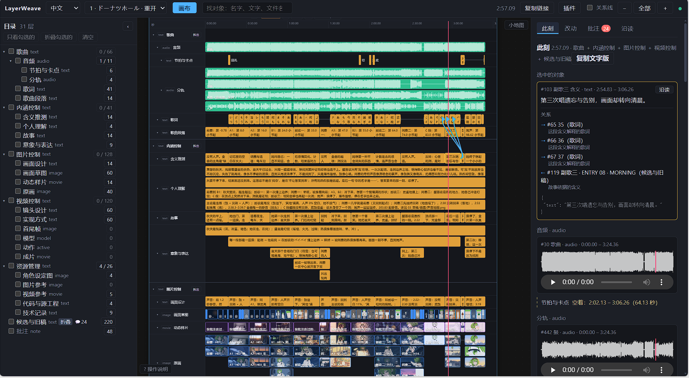
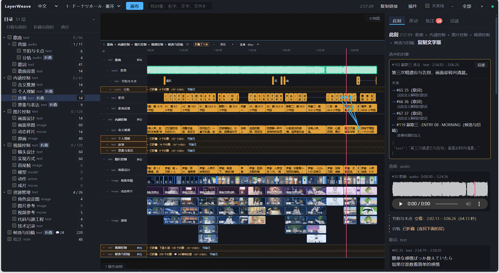
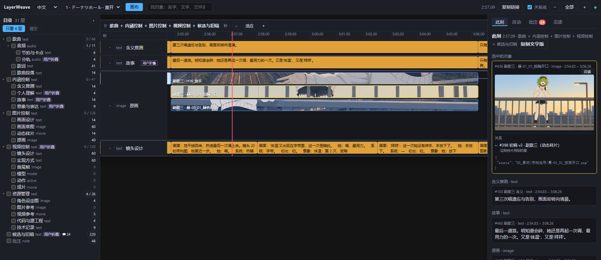

# LayerWeave

**简体中文** | [English](README.en.md)

[GitHub](https://github.com/aceddad/LayerWeave/tree/visualization) · [Gitee](https://gitee.com/emotion1354414/layer-weave/tree/visualization) · [快速安装](#快速安装) · [开始使用](#开始使用) · [接入 AI](#接入-ai) · [开发与扩展](#按需组合开发自己的工具)

**少分心：只看相关的那一段，只做眼前的那一件事。**

LayerWeave 是面向 AI 使用与开发的信息管理工具。正文、素材引用、证据和批注按时间、段落或阅读顺序组织，再通过层级和关联连接。AI 通过 MCP 按需查询、编辑和截图；人可以在同一份项目上查看、定位和留言。



*真实手书制作项目：音频、分轨、故事、分镜与原画按时间组织，右侧“此刻”查看选中对象及当前位置的内容和关联。完整制作素材不随安装包提供。[查看原图](docs/images/handdraw-workspace.png)。*

## 快速安装

当前为 **0.7.10b1 Windows 预览版**。在 PowerShell 中任选一种方式安装：

本版新增工具表 BLOB 与注销托管，并加快批量写入和历史读取；见[更新说明](https://github.com/aceddad/LayerWeave/releases/tag/v0.7.10b1)。

> 安全更新：npm 启动器会跳过 PATH 中低于 0.13.4 的 uv，使用修复版；显式指定的旧版会提示更新。自行使用 pip 安装时，请先更新到 pip 26.2.2 或以上，已有的 certifi 应更新到 2026.10.19 或以上。升级 LayerWeave 不会替你更新其他 Python 环境，详见 [Python 证书事件公告](https://discuss.python.org/t/information-for-python-users-regarding-emudhra-emsign-ca-certificate-security-incident/109576)。

使用 [uv](https://docs.astral.sh/uv/getting-started/installation/) **0.13.4 或更新版本**，同时安装 MCP 依赖：

```powershell
uv tool install --python 3.11 "layerweave[mcp]==0.7.10b1"
```

使用 Node.js 20+ / npm（Windows x64）：

```powershell
npm install -g layerweave@0.7.10-beta.1
```

安装完成后使用 `layerweave` 命令。uv 会准备独立 Python 环境；npm 安装启动器，首次执行时再自动准备 Python 和所需依赖。首次准备需要联网。**安装本身不会创建案例或打开视图。** 如果找不到命令，按安装器提示设置命令目录，再重新打开终端和 MCP 客户端。

## 开始使用

### 接入 AI

**推荐通过 MCP 让 AI 使用 LayerWeave。** AI 可以按需发现工具、查询和修改项目、查看相关画面并处理批注。配合视图，人可以查看同一份项目并留下反馈。Python/CLI 接口也可供脚本与自己的工具直接调用。

<details>
<summary>展开 MCP 接入配置（已通过 uv 或 npm 安装）</summary>

选择自己的工作目录，以下以 `D:/my-layerweave` 为例。在该目录保存 `mcp.json`：

```json
{"workspace": "D:/my-layerweave"}
```

通过 uv 安装后，在客户端的 MCP 配置中加入：

```json
{
  "mcpServers": {
    "layerweave": {
      "command": "layerweave",
      "args": ["mcp", "--config", "D:/my-layerweave/mcp.json"]
    }
  }
}
```

通过 npm 安装时，将其中的 `layerweave` 服务项替换为下面这项（Windows）：

```json
{
  "command": "cmd",
  "args": ["/c", "layerweave", "mcp", "--config", "D:/my-layerweave/mcp.json"]
}
```

配置放在哪里取决于客户端，示例路径需要换成实际路径。若客户端找不到命令，通过 uv 安装的可用 `(Get-Command layerweave).Source` 查看程序位置；通过 npm 安装的可用 `(Get-Command layerweave.cmd).Source` 查看启动脚本位置。

接入后，先让 AI 调用 `layerweave_help`，按任务查找工具，再创建或打开你自己的项目。无需先运行 demo。客户端管理服务进程，MCP 启动本身不打开画布。

默认数据库、项目、工具暴露，以及 uvx/npx 和自管 Python 环境的接法见 [MCP 说明](src/layerweave/tool/builtin/shared/mcp/README.md)与[npm 运行环境](src/layerweave/tool/builtin/shared/launcher/README.md#npm-运行环境)。

</details>

### 打开或创建自己的项目

| 命令 | 用途 |
|---|---|
| `layerweave --help` | 查看可用命令 |
| `layerweave view ./project.sqlite3` | 打开已有数据库 |
| `layerweave new ./my-project --template subtitles` | 用字幕模板创建自己的项目并打开视图 |
| `layerweave help project_overview` | 查看项目概览工具的帮助 |

视图与 MCP 可以分别使用，也可以访问同一个项目。打开视图后保持终端运行，按 Ctrl+C 停止服务；加 `--no-browser` 可只打印访问地址。

### 可选：体验案例

```powershell
layerweave demo
```

默认打开文章解析案例，保存在 `./layerweave-demo/article-reading`。**再次运行同一条命令会保留对象、批注、布局和素材修改。** 用 `layerweave demo --list` 查看十二个案例，其他案例按需下载；例如 `layerweave demo comic-creation --dir ./my-comic`。

<details>
<summary>无需预先安装，直接体验</summary>

已有 uv 或 npm 时，也可任选一条直接运行：

```powershell
uvx layerweave@0.7.10b1 demo
```

```powershell
npx --yes layerweave@0.7.10-beta.1 demo
```

</details>

项目数据与下载缓存分开保存。更多参数见[统一入口说明](src/layerweave/tool/builtin/shared/launcher/README.md)，安装文件见 [GitHub Releases](https://github.com/aceddad/LayerWeave/releases/tag/v0.7.10b1)。在 Python 工程中导入或扩展内核，请从[开发入口](#按需组合开发自己的工具)开始。

## 把注意力留给当前这一段

### 按需收起内容

暂时不看的层可以折叠，名称、对象数量和展开入口仍然保留。把画面留给当前工作，需要时再展开。



*[查看折叠视图原图](docs/images/handdraw-folded.png)。折叠改变显示，不删除内容。*

### 同一份数据，各自选择关注范围

同一个 **2:57** 时刻，AI 只查看相关四层，并独立选择一张原画。它可以读取对象正文和关联，也可以按需要截图；这些临时筛选不改变人的浏览状态。



*[查看 AI 局部视图原图](docs/images/ai-focus-177.png)。图中的“用户折叠”标记保留了人的关注状态，AI 仍可按任务查看对应内容。*

| 工作中的需要 | LayerWeave 提供的能力 |
|---|---|
| 留下可追溯的反馈 | 批注、回复、待处理状态；意见挂在具体内容上，方便之后接着处理 |
| 查看 AI 改到哪里了 | 画布每两秒同步项目变化，按位置查看新增或修改的内容 |
| 修正已经写入的内容 | 改动记录、历史与撤销；覆盖冲突会明确报告 |

视频和歌曲可以按秒，文章按段落，漫画按页和格。轴的单位由项目解释，段落、页码与秒不会自动换算。图片和音视频通过路径或链接引用；生成、处理媒体由技能或外部工具完成。

截图理解需要有视觉能力的 AI；何时读取批注、由哪个 AI 处理，由调用方安排。具体工具与调用方式可以从 help 按需查询，或阅读[视图使用说明](src/layerweave/tool/builtin/view/GUIDE.md#给-ai-用)。

## 换一个场景试试

| 案例 | 可以怎样用 |
|---|---|
| [文章解析](examples/showcases/article-reading/README.md) · 推荐入门 · [截图](docs/images/article-reading.png) | 将正文与逐段解读对照，从论点追溯证据、配图和讨论 |
| [动态分镜与 H3](examples/showcases/donut-hole-h3/README.md) | 对照镜头、故事段落与实现方式，追溯共用的素材 |
| [手书制作](examples/showcases/donut-hole-tegaki/README.md) | 将听感、故事、画面设计、角色设定与实现记录放在一起 |
| [晚开的花](examples/showcases/late-bloom-scroll/README.md) | 四个 AI 通过批注核对接缝和配色，共同完成一幅动态 SVG 长卷 |

十二个案例还覆盖小说、漫画、课程、调查、互动故事、需求设计、翻译审校和代码梳理，见[完整案例目录](examples/showcases/README.md)。文章解析使用原创短论；手书与 H3 为不附歌曲和视频的静帧阅读版，完整影片需要另备素材。

## 按需组合，开发自己的工具

LayerWeave 的核心理念是**降低注意力的分散**。找东西、对位置、记改动这些事交给工具；开发一个新功能时，也应能专注它自身的逻辑。

做法是**按需组合**：对象放进层，层组成树，通过 `bind` 关联彼此；内核提供基本结构，基础支撑负责保存、编号、事务和改动记录，工具、技能与插件按用途接入。核心和基础支撑只依赖 Python 标准库。

比如，要汇总“每个角色出现在哪些镜头”，可以写一个工具查询现有关系；保存结果时复用已有的读写和记录能力，配合撤销工具恢复改动。工具也可以声明自己的表，不必把所有数据都塞进层和对象。

**欢迎你和 AI 基于这个内核开发自己的应用。** 本分支是一个可直接使用的上层应用示例，视图本身也是工具包。内置工具展示如何复用内核，独立视图插件进一步展示如何扩展应用。批注就是其中一个例子：`Note` 继承文字对象，回复通过关联表达，已读状态与布局保存在视图自己的表里。

- [main 开发分支](https://github.com/aceddad/LayerWeave/tree/main)：无视图的内核、基础支撑与非视图工具，带最小 Python 示例。
- [扩展指南](docs/build-with-layerweave/README.md)：新增类型、自己的表、组合工具或接入增量变化。
- [公共 API](src/layerweave/support/API.md)与[工具表例子](examples/tool_tables.py)：复用已有能力开发功能。
- [官方视图插件](https://github.com/aceddad/layerweave-plugins)：一览、接缝、预览和网页插件独立选装。

## 文档与可选组件

[使用工具](src/layerweave/tool/builtin/usage/README.md) · [JSON 交换与模板](src/layerweave/tool/builtin/usage/exchange/README.md) · [视图与插件](src/layerweave/tool/builtin/view/README.md) · [维护源码](docs/developer-conventions.md) · [文档目录](docs/README.md)

普通数据管理和文章案例不需要 API KEY、FFmpeg 或官方视图插件。服务端抽帧、视频缩略图和波形需要[选装 FFmpeg](src/layerweave/tool/builtin/view/GUIDE.md#选装-ffmpeg)；AI 截图需要 Chrome、Edge 或 Chromium。网页支持中英文，当前发行包的视图组件为 0.31.1。

## AI 协作开发

项目由维护者主导设计与维护，Astra（Codex）与 Claude 协助本分支的开发、测试和文档整理。

## 许可证

LayerWeave 自身采用 [MIT](LICENSE)。随包网页组件保留各自许可，见[第三方声明](THIRD_PARTY_NOTICES.md)；独立插件、技能和外部服务遵循各自的说明。
