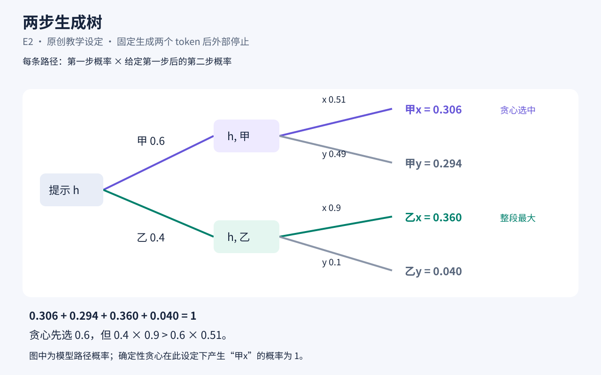
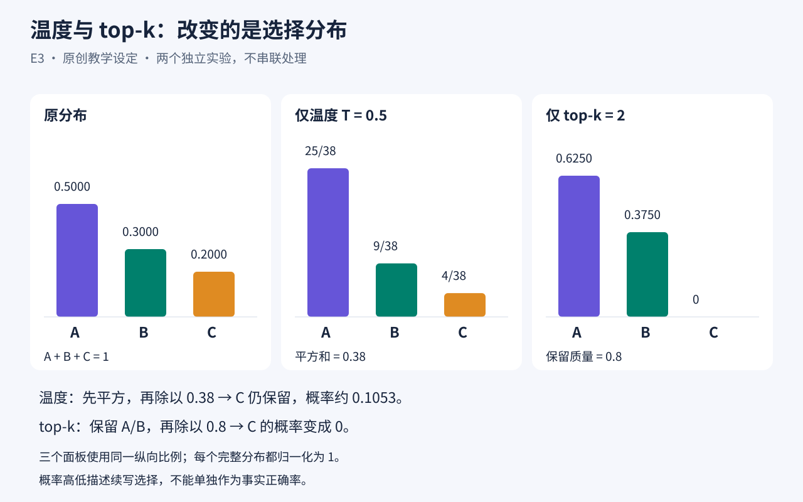

# 大模型怎样一步步生成回答

先按[案例目录的 uv 步骤](../README.md#准备环境)设置 `$casePython`，再进入本案例目录执行以下 PowerShell 命令。

一节约 20 分钟的微课：从 token、上下文和条件分布出发，手算两步生成，再比较贪心、温度与 top-k。适合会小数乘除、希望理解大模型生成过程的读者；无需编程知识、GPU、模型账号或付费服务。

学完后，你应能解释“条件发生了什么变化”，算出一条续写路径的模型概率，区分逐步贪心与整段最大概率，并指出为什么生成概率不能直接当成事实正确率。

所有概率、词表、切分和情景都是**教学设定**，不是某个真实大模型的实测结果。本课不覆盖训练方法、注意力机制或完整模型架构。

## 内容与学习路线

项目包含 8 个层、24 个对象、44 条有说明的关联。轴的单位是“学习步”，只表示阅读顺序，不代表分钟或数据库编号。

| 分组 | 内容 |
|---|---|
| 学习主线 | 起点、终点，以及下列四个子层 |
| 知识点 | K1 token与上下文；K2条件分布；K3链式乘法；K4贪心与采样；K5温度与top-k；K6概率与事实 |
| 讲解例题 | E1换条件；E2两步路径比较；E3改变分布 |
| 自测练习 | Q1、Q2、Q3，只放题目 |
| 教学图像 | 两幅可直接打开的原创SVG |
| 答案与解释 | A1、A2、A3；子层“常见误解与补习”含M1到M4 |
| 资料与许可 | 概念出处、素材来源和复用说明 |

建议按下面顺序完成；时间是参考估计，可按需要停下复算。

| 阅读顺序 | 预计用时 |
|---|---:|
| 起点｜20分钟学会读懂一次生成 | 1分钟 |
| K1 → K2 → K3 | 4分钟 |
| E1｜生成一个 token 后，条件变了 | 1分钟 |
| K4 → E2，打开图1 | 4分钟 |
| Q1、Q2，作答后分别查A1、A2 | 3分钟 |
| K5 → E3，打开图2 | 3分钟 |
| Q3，作答后查A3 | 2分钟 |
| K6 → 终点｜用自己的话解释一次生成 | 2分钟 |

**先做题、后查答案：**在画布目录中勾选“自测练习”，再点“只看勾选的”；或用名称查询单道Q题。写下答案后再查同号A对象。答案到练习有“答案对应”关联，可以从练习查入向关联找到。分组帮助控制阅读顺序；答案没有权限限制，也没有强制隐藏或自动评分。默认全部显示时，同一步的答案也会出现；仅展开目录并不筛掉答案。

## 准备与导入

使用已经安装 LayerWeave 的 Python 环境；本案例使用交换格式 v1，以 LayerWeave 0.7.8 验证。普通 Python/CLI 安装即可完成导入、文本阅读、关联查询、编辑、导出与复查。以下命令使用 uv 准备的 `$casePython` 解释器。

先把整个 `case/` 目录复制到自己的可写工作目录，再进入这份副本。保持以下摆放方式：

```text
case/
├─ README.md
├─ project.json
├─ assets/
│  ├─ two-step-tree.svg
│  └─ decoding-distributions.svg
└─ course.sqlite3                 # 运行命令后生成
```

在该目录中运行：

```powershell
& $casePython -X utf8 -m json.tool project.json > parsed-project.json
& $casePython -X utf8 -m layerweave.tool.builtin.developer.database.cli course.sqlite3
& $casePython -X utf8 -m layerweave.tool.builtin.usage.exchange.cli apply course.sqlite3 --data-file project.json --new-project --result-file import-result.json
```

导入应显示 `completed`、创建76条、跳过0条。新项目另外创建，76条计数为8层、24对象和44关联。还应检查反馈中的 `checks` 与 `data.issues`。`add` 操作重复执行会再创建一套内容，不是幂等更新。

用下面的标准 Python 命令读取实际项目编号和 key→编号映射；不预设任何项目或对象ID：

```powershell
& $casePython -X utf8 -c "import json; r=json.load(open('import-result.json',encoding='utf-8')); print('PROJECT_ID =',r['data']['project_id']); print('\n'.join(str(m['source'].get('key','project'))+' -> '+str(m['target']['id']) for m in r['data']['id_map']))"
```

后续示例中的 `PROJECT_ID`、`OBJECT_ID`、`LAYER_ID` 是需替换的占位符。使用刚才的映射，也可以按名称查询并取得 `id`：

```powershell
& $casePython -X utf8 -m layerweave.tool.builtin.usage.query.project_overview course.sqlite3 PROJECT_ID
& $casePython -X utf8 -m layerweave.tool.builtin.usage.query.find_objects course.sqlite3 PROJECT_ID --name "Q2｜"
& $casePython -X utf8 -m layerweave.tool.builtin.usage.query.project_details course.sqlite3 PROJECT_ID --layer-ids LAYER_ID --json
& $casePython -X utf8 -m layerweave.tool.builtin.usage.validation.cli course.sqlite3 PROJECT_ID --json
```

`find_objects` 会返回对象正文；只读某道练习时不必展开答案层。交换工具只处理数据，**不会复制素材**。两个 `information.source` 都相对于数据库所在目录解析；移动数据库时应同时带上 `assets/`。

## 五个可以跟着完成的体验任务

以下名称都能用 `find_objects --name` 定位；`K2｜` 等前缀足以唯一匹配。关系是标准 `bind`，语义写在关系的 `tips` 中。

1. **从概念读到例题。**先读“K2｜下一 token 的条件分布”，沿它的“相近例题”关系找到“E1｜生成一个 token 后，条件变了”。预期看见：给定“我想喝”时查第二张表；下一步“茶”为0.7，从旧提示续写“喝 茶”则为0.35。可先沿“先修”读K1，或沿例题“用到”补读K3。
2. **从练习定位两个知识点。**找到“Q2｜换一组数，还会选错整段吗”，查询出向关联。预期“需用”关联分别指向“K3｜自回归与链式乘法”和“K4｜贪心与采样：局部选择和整段概率”，正文分别解决乘法和贪心比较问题。
3. **从错误解法返回补习。**找到“M2｜错解：每一步最大就保证整段最大”，沿“纠正”到K4，再沿“相近例题”到E2，打开图1。预期比较0.306与0.36；然后回Q2再做一次，查A2发现这一次贪心恰好最大。
4. **寻找先修。**从“K5｜温度、top-k 与重新归一化”查看“先修”关系，找到K2和K4。预期理解：先懂完整分布与采样，再讨论怎样改变分布；关系说明给出为何需要这些知识。
5. **验证数值与条件变化。**完成Q3后查“A3｜Q3答案：分母跟着候选权重变”。用下方命令复算；解释仅做top-k时，上下文保持不变，允许候选从A/B/C变为A/B，所以分母为0.9。再对照Q1：那里的变化是上下文追加了“喝”。

查关联和沿读的通用命令：

```powershell
& $casePython -X utf8 -m layerweave.tool.builtin.usage.query.relations course.sqlite3 PROJECT_ID object OBJECT_ID --direction outgoing
& $casePython -X utf8 -m layerweave.tool.builtin.usage.query.walk course.sqlite3 PROJECT_ID object OBJECT_ID --direction outgoing --max-depth 2
```

从Q题查答案时用 `--direction incoming`；从M2补习时用出向两步。深度两步会同时列出范围内的其他关系，请按 `tips` 中的“纠正”和“相近例题”选路，不把所有箭头都当成先修。

Q3的复算只需标准库：

```powershell
& $casePython -X utf8 -c "from fractions import Fraction as F; p=[F(6,10),F(3,10),F(1,10)]; w=[x*x for x in p]; print('temperature:',[str(x/sum(w)) for x in w]); print('top-k:',[str(x/sum(p[:2])) for x in p[:2]]+['0'])"
```

预期为温度 `18/23, 9/46, 1/46`，top-k `2/3, 1/3, 0`。

## 图像、可选画布与编辑

两幅SVG可在普通浏览器离线打开，无需安装绘图库：

- [图1：两步生成树](assets/two-step-tree.svg)，对应E2。
- [图2：温度与top-k](assets/decoding-distributions.svg)，对应E3。





若使用带视图功能的 **visualization 完整版**，可打开画布、看图像缩略图、选对象并沿关系阅读。普通无视图安装无需执行这一段，也不需要安装额外插件：

```powershell
& $casePython -X utf8 -m layerweave.tool.builtin.view.server course.sqlite3 --project PROJECT_ID --port 8876
```

打开终端给出的本机地址；若端口已被占用，换一个空闲端口。先勾选“自测练习”，点“只看勾选的”，再点该层的对象数列出题目，选Q对象，在右侧读题。做完再次点击“只看勾选的”恢复全部，到“答案与解释”找同号A对象；对象详情的“沿读”可按方向和步数展开关系。显示筛选只用于方便阅读，关联中仍会显示答案对象的名称。

这些文本、图像引用和关系均为正常项目内容，可继续编辑。需要批量修改时先导出，修改原对象的 `information.text` 后写回，保留导出的身份字段与引用：

```powershell
& $casePython -X utf8 -m layerweave.tool.builtin.usage.exchange.cli export course.sqlite3 PROJECT_ID --include-baseline --output editable.json
& $casePython -X utf8 -m layerweave.tool.builtin.usage.exchange.cli apply course.sqlite3 --data-file editable.json --result-file edit-result.json
```

不要为了更新文字重新导入原始 `add` 文件；`information` 是整体替换字段，编辑时保留需要的其他内容键。

## 依据与许可

概念参考了 Hugging Face 官方的 [tokenization说明](https://huggingface.co/docs/transformers/main/tokenizer_summary)、[生成策略说明](https://huggingface.co/docs/transformers/main/generation_strategies)及[生成方法教程](https://huggingface.co/blog/how-to-generate)（查阅于2026-10-20）。只作概念核对，未复制网页图片或长段文字；不依赖教程代码或某个具体模型版本。

中文讲解、题目、虚构数据与两幅SVG均为本案例原创，可按 [CC BY 4.0](https://creativecommons.org/licenses/by/4.0/) 复用，署名“LayerWeave课程案例：大模型怎样一步步生成回答”。外部参考网页的权利归原作者，不在上述授权范围内。
